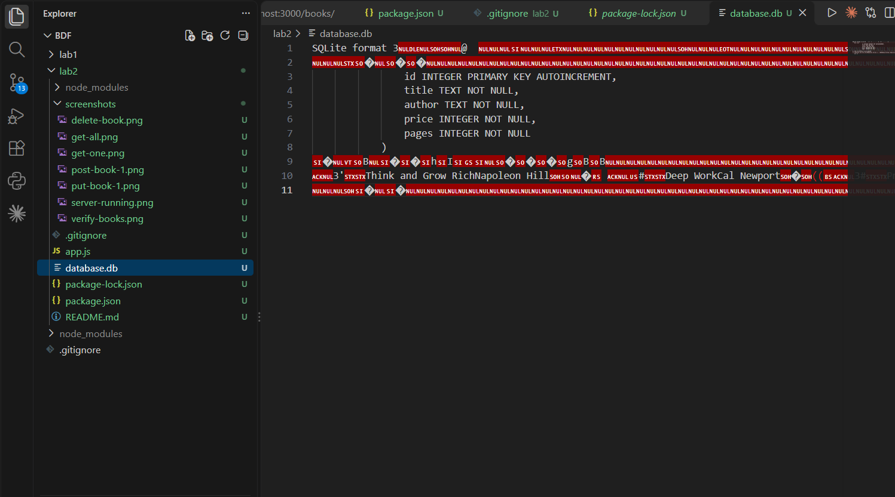
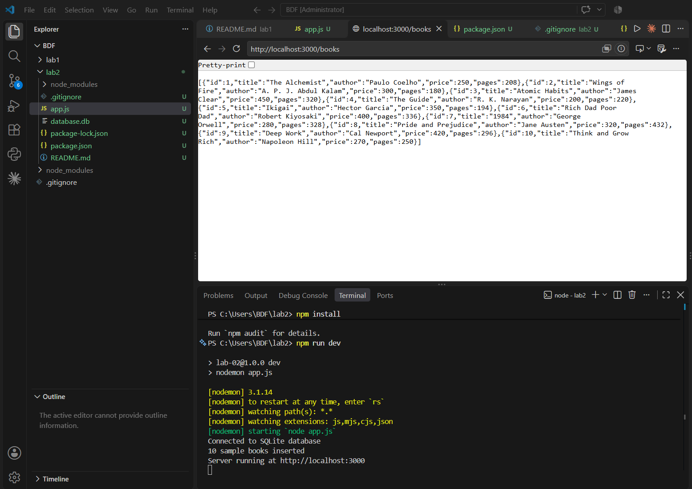
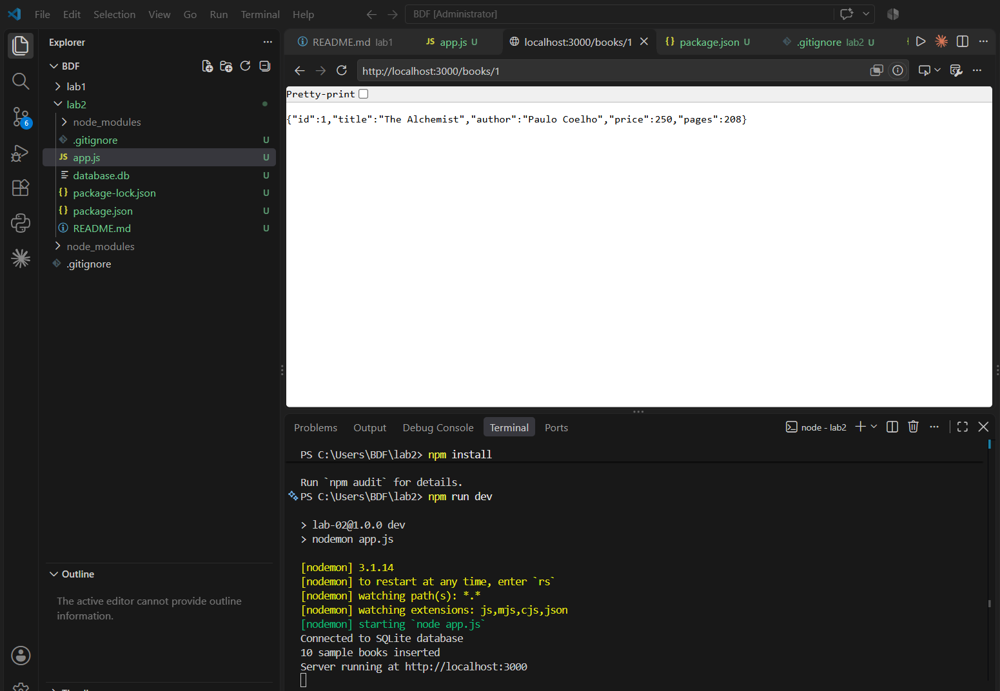
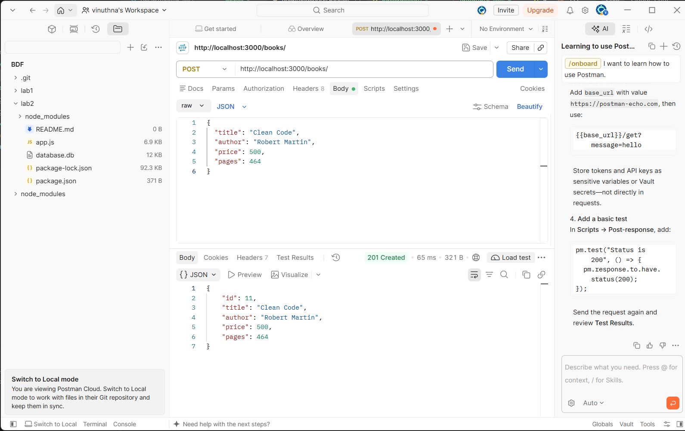
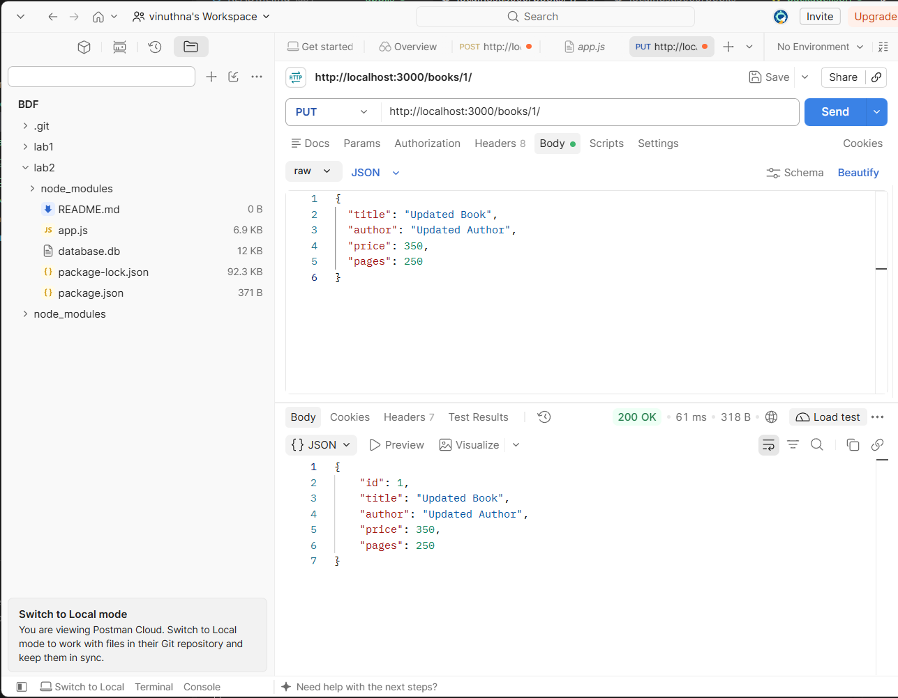
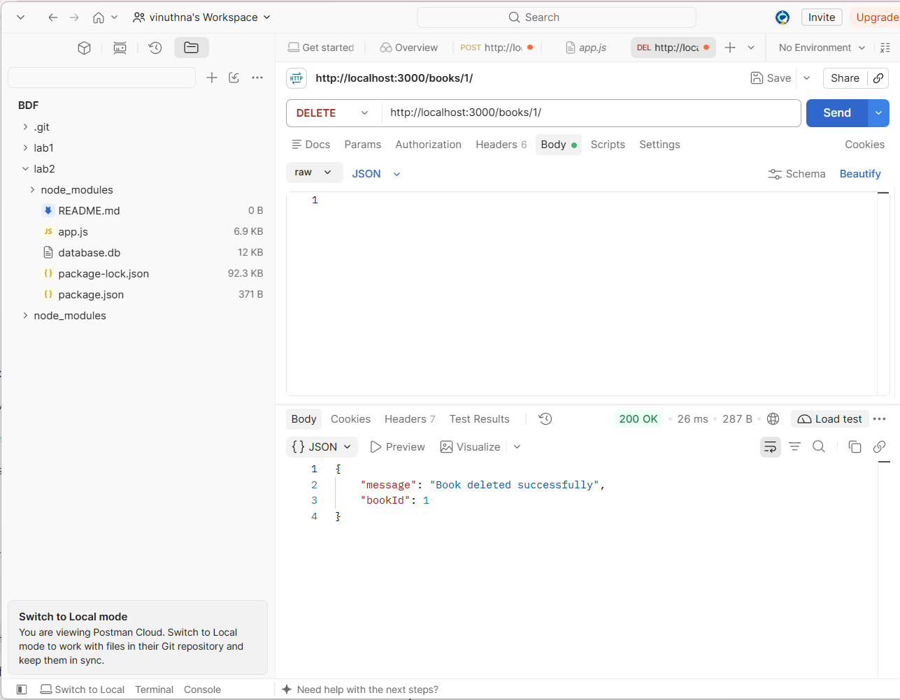
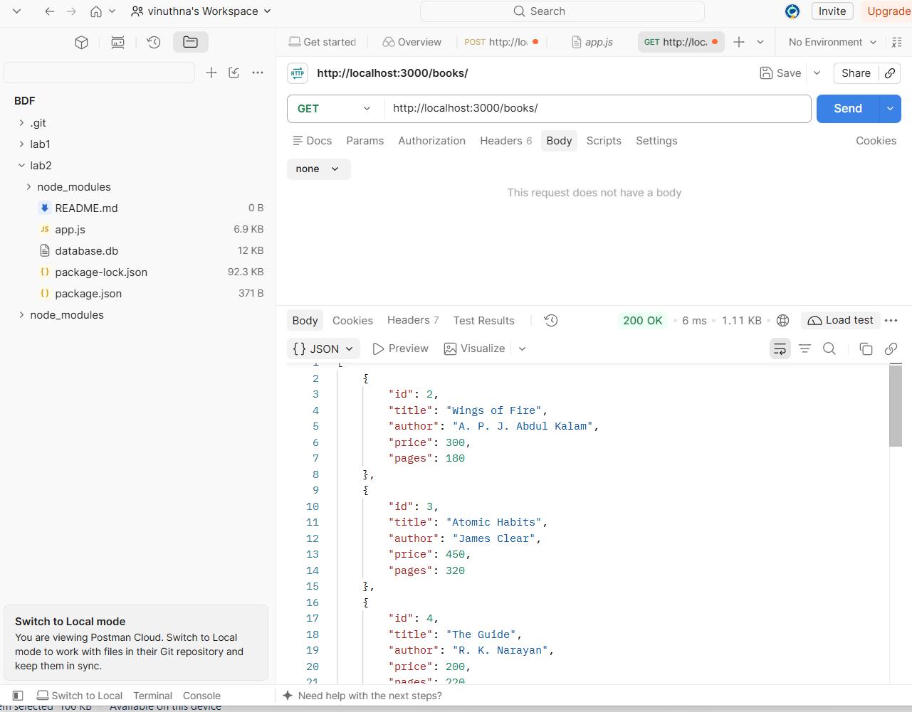
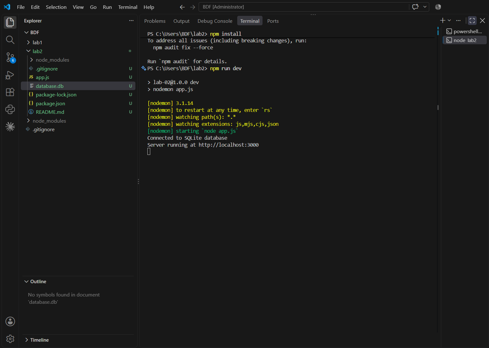

# Lab 2: SQLite Database and CRUD Routes

**Name:** BAJJURI VINUTHNA
**Registration Number:** 252U1R5017
**Section:** S-10
**Course:** Backend Development Fundamentals
**Institution:** Aurora Deemed to be University
**Faculty:** SHIVA SAI TEJA

## Live Link

**Status:** Not deployed yet.

This project has been tested locally using Postman. The current version uses a local SQLite database file (`database.db`). Postman screenshots are included as evidence of the working endpoints. A public deployment URL will be added after deployment.

## Objective

To connect an Express server to an SQLite database and implement CRUD operations through HTTP routes.

CRUD stands for Create, Read, Update, and Delete.

## Technologies Used

- Node.js
- Express.js
- SQLite
- sqlite3
- sqlite
- Nodemon
- Postman
- Visual Studio Code

## Project Structure

BDF
lab2/
├── screenshots/
│   ├── database.png
│   ├── get-all.png
│   ├── get-one.png
│   ├── post-book-01.png
│   ├── put-book-01.png
│   ├── delete-book.png
│   ├── verify-books.png
│   └── server-running.png
├── database.db
├── package.json
├── package-lock.json
├── README.md
└── app.js
```

The `node_modules` folder is excluded from GitHub using `.gitignore`.

## Requirements

- Node.js and npm
- SQLite command-line tools
- Postman
- Visual Studio Code

## Installation and Setup

1. Open the `lab2` folder in VS Code.
2. Open the terminal and run:

   ```bash
   npm install
   ```

3. Make sure `database.db` is present inside the `lab2` folder.
4. Start the server:

   ```bash
   npm run dev
   ```

5. The server should start at:

   `http://localhost:3000`

The terminal should display messages confirming that the database is connected and the server is running.

### Environment Variables

No environment variables are currently required by this local version of the project.

## SQLite Database

The database file is named `database.db`. It contains a `book` table with the following columns:

| Column | Data type | Description |
|---|---|---|
| `id` | INTEGER | Primary key |
| `title` | TEXT | Book title |
| `author` | TEXT | Author name |
| `price` | INTEGER | Book price |
| `pages` | INTEGER | Number of pages |


## API Endpoints

The server provides the following five endpoints.

| HTTP Method | Endpoint | Description |
|---|---|---|
| GET | `/books/` | Retrieves all books |
| GET | `/books/:bookId/` | Retrieves a book by its ID |
| POST | `/books/` | Adds a new book |
| PUT | `/books/:bookId/` | Updates an existing book |
| DELETE | `/books/:bookId/` | Deletes a book by its ID |

### Example POST and PUT Request Body

```json
{
  "title": "Clean Code",
  "author": "Robert Martin",
  "price": 500,
  "pages": 464
}
```

## Testing

All five API endpoints are tested using Postman.

- GET requests retrieve book records.
- POST adds a new book.
- PUT updates an existing book.
- DELETE removes a book.
- A final GET request verifies the database changes.

Parameterized SQL queries with `?` placeholders are used for queries that accept user input.

## Screenshots

### 1. SQLite Database



### 2. GET All Books



### 3. GET One Book



### 4. POST — Add a Book



### 5. PUT — Update a Book



### 6. DELETE — Delete a Book



### 7. Verify Database Changes



### 8. Server Running



## Problems Faced and Solutions

1. **SQLite command-line setup:** I extracted the SQLite tools and used the `sqlite3.exe` executable to create and inspect the database.
2. **Database connection:** I connected the Express application to `database.db` and used an asynchronous initialization function to start the server after the database connection succeeded.
3. **Testing HTTP methods:** I used Postman to test GET, POST, PUT, and DELETE requests and check their responses.
4. **Verifying database changes:** I used GET requests and SQLite queries to inspect the records after changes.

## Conclusion

This lab helped me understand how to connect an Express server to an SQLite database and implement CRUD operations. I learned to test HTTP endpoints using Postman, use parameterized SQL queries, and verify database changes.